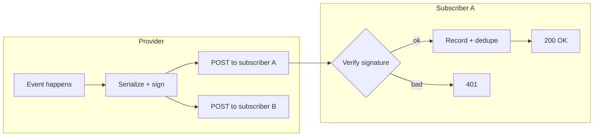

# Anatomy of a delivery

Strip away any vendor's branding and every webhook delivery looks the same:
an HTTP `POST` with a JSON body and a handful of headers.

## A real delivery from this repo

```http
POST /webhooks/receive HTTP/1.1
Content-Type: application/json
X-Webhook-ID: evt_3f9a1c2b4d5e
X-Webhook-Event: order.created
X-Webhook-Delivery: 7c8d9e0f1a2b3c4d5e6f7a8b9c0d1e2f
X-Webhook-Attempt: 1
X-Hub-Signature-256: sha256=50f949c859a7cd1c6…

{"id":"evt_3f9a1c2b4d5e","type":"order.created","created_at":"…","data":{"order_id":42}}
```

## The five pieces

### 1. The event type

`X-Webhook-Event: order.created` — a `noun.verb` string saying *what
happened*. Subscribers subscribe to specific types. Conventions:

- GitHub: `X-GitHub-Event: push`, `pull_request`, `issues` …
- Stripe: the type is inside the body (`"type": "payment_intent.succeeded"`)
- This repo: `X-Webhook-Event`, and also as `type` inside the payload

### 2. The event

The payload body — JSON in virtually every modern provider:

```json
{
  "id": "evt_3f9a1c2b4d5e",
  "type": "order.created",
  "created_at": "2026-11-13T04:05:13+00:00",
  "data": { "order_id": 42, "total": "9.99" }
}
```

`id` identifies the *event*. One event can produce many deliveries (one per
subscriber), so event ID ≠ delivery ID.

### 3. The delivery ID

`X-Webhook-Delivery` — unique per (event, subscriber) pair, **and it's the
same across retries** of that delivery. This is what a receiver deduplicates
on. GitHub calls it `X-GitHub-Delivery`; Stripe calls retries "resends" of
the same event.

### 4. The signature

`X-Hub-Signature-256: sha256=<hmac>` — proves the sender knows the shared
secret and the body wasn't tampered with. Covered in depth in
[Security](../security.md).

### 5. The response contract

The subscriber answers with a status code only — the body is ignored:

| Response | Provider interprets as |
|---|---|
| `2xx` | Success — mark delivered, stop retrying |
| `4xx` | Failure — usually retried (some providers treat `410 Gone` as "unsubscribe me") |
| `5xx` / timeout | Failure — retry with backoff |

!!! tip "Respond fast"
    Providers time out quickly (GitHub: 10s, Stripe: ~20s, Twilio: 15s). Do
    the slow work — DB writes, API calls — *after* responding. In this repo
    everything is in-memory so responses are instant.

## The loop, end to end



Retry behaviour is part of the anatomy too — the same `X-Webhook-Delivery`
arriving with `X-Webhook-Attempt: 2` means "the provider thinks attempt 1
failed". See [Sending](../sending.md) for the retry mechanics.
