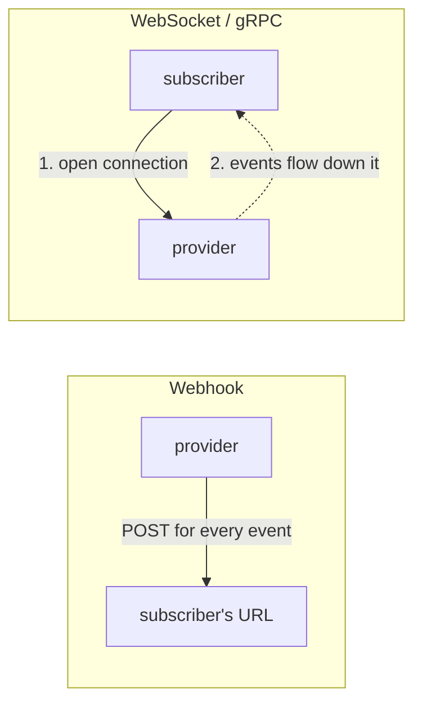

# Alternatives to webhooks

Three sibling playgrounds implement the same toy flow — *something
happened, tell the interested parties* — once per mechanism:

| | **Webhook** | **WebSocket** | **gRPC stream** |
| --- | --- | --- | --- |
| Transport | new HTTP `POST` per event | one long-lived TCP connection | one long-lived HTTP/2 stream |
| Who connects to whom | provider → subscriber's **public URL** | subscriber → provider (then both ways) | subscriber → provider |
| Subscriber needs | a reachable endpoint + a shared secret | nothing but the ability to connect out | nothing but the ability to connect out |
| Auth | HMAC signature per delivery | TLS / headers on the handshake | TLS / call credentials |
| If subscriber is down | provider retries, then dead-letters | the socket is gone — no delivery, no retry | the stream ends — reconnect and resubscribe |
| Playground | this repo — `POST /emit` → `app/dispatcher.py` | `../websockets-101` | `../grpc-101` |

## The key insight

A webhook is the odd one out: **the provider calls the subscriber**, so the
subscriber must be a publicly reachable server that can verify signatures
and tolerate retries and duplicates.

WebSockets and gRPC streams invert that: **the subscriber dials out and
holds the line open**. No public URL, no signature, no retry log — the
open connection itself *is* the subscription.

## When to reach for which

- **Webhook** — notifying *other people's servers* you don't control
  (GitHub → your app). Works through NAT/firewalls only because the
  subscriber publishes a URL; survives restarts via retries.
- **WebSocket** — pushing to *live clients* you do control: browsers,
  dashboards, chat, trading UIs. Full-duplex, tiny per-message overhead.
- **gRPC** — service-to-service RPC with a contract. The `.proto` *is* the
  API spec; you get streaming in four directions plus code generation,
  deadlines, and status codes for free. Server-to-browser needs a proxy
  (gRPC-Web).

## Same event, three transports

The three playgrounds emit the identical event — the JSON body a webhook
subscriber gets as a `POST` is the same shape a socket frame or a
protobuf `Event` carries. The payload is the easy part; the interesting
differences are all in *who connects to whom* and *what happens when the
other side isn't there*.
