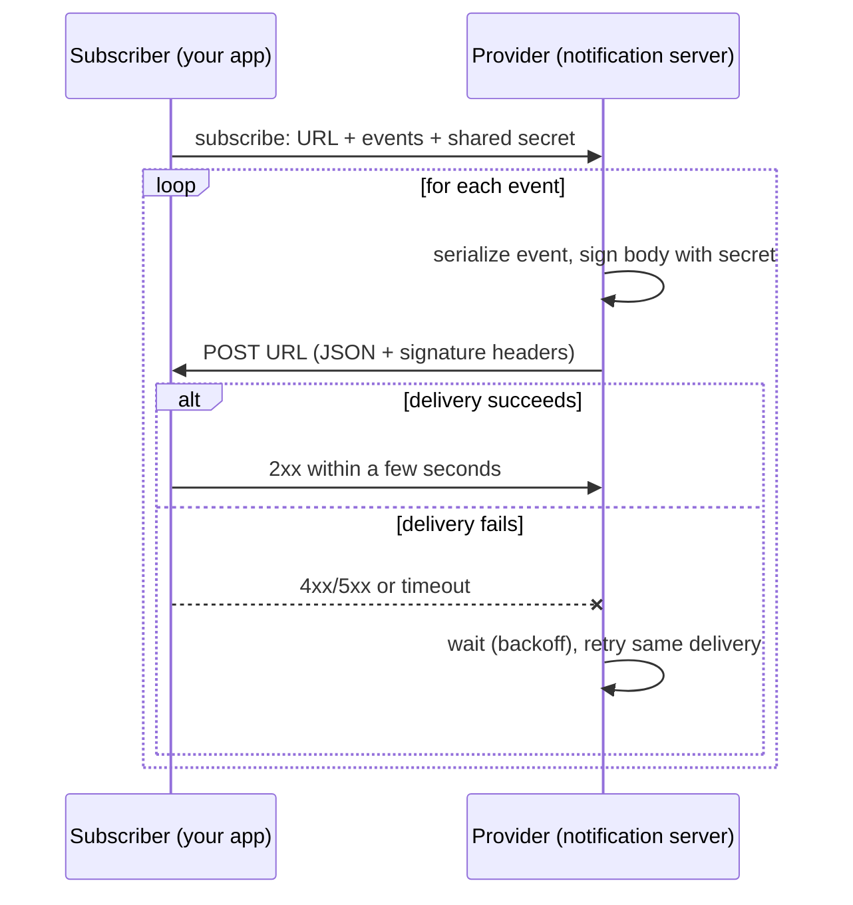

# The players: who is the subscriber?

Webhook documentation uses overlapping vocabulary, so let's pin it down.

## Roles

### The provider (a.k.a. publisher, sender, *notification server*)

The service where events originate: GitHub (pushes, PRs), Stripe (payments),
Twilio (SMS), Shopify (orders) — and this repo's `/emit` + `dispatcher.py`.
Its responsibilities:

- Offer a way to **subscribe**: a UI page, an API, or both.
- When an event happens, **deliver** it: a signed HTTP `POST` to every
  subscribed URL.
- **Retry** when delivery fails, and keep a delivery log you can inspect.

### The subscriber (a.k.a. consumer, receiver, listener)

**Whoever wants the notification.** The subscriber owns a publicly
reachable URL and tells the provider "call this when X happens". When you
paste `https://yourapp.com/github-hook` into a GitHub repo's webhook
settings, *your app* is the subscriber and *GitHub* is the provider.

The subscriber's responsibilities:

- Expose an HTTPS endpoint that accepts the provider's `POST`s.
- **Verify** each request (signature) before trusting it.
- **Respond fast** (`2xx` within a few seconds) and process asynchronously.
- Be **idempotent** — the same delivery may arrive more than once.

## Terminology cheat sheet

| Term you'll see | Usually means |
|---|---|
| "webhook" (the noun) | The *subscription* itself — the registered URL + event filter |
| "webhook server" | The subscriber's endpoint — the HTTP server that receives calls |
| "notification server" | Ambiguous! Can mean the provider's delivery engine *or* your receiver. Ask: is it sending or receiving the POST? |
| "endpoint" / "callback URL" | The subscriber's URL |
| "delivery" | One attempt-group of one event to one subscriber |
| "consumer" | The subscriber's application |
| "target URL" / "payload URL" | Same as callback URL (GitHub's UI calls it *Payload URL*) |

!!! warning "The provider is *not* a server you run"
    A common beginner confusion: "do I need to run a webhook server to
    *send* webhooks?" The provider's delivery machinery (queues, retries)
    lives on *their* side. To receive webhooks you only run the subscriber
    side — a plain HTTP endpoint. This repo implements both so you can see
    each.

## The contract between them

| The subscriber owes the provider | The provider owes the subscriber |
|---|---|
| A publicly reachable HTTPS URL | Signed, documented payload format |
| A fast `2xx` response | Retries with backoff on failure |
| Idempotent processing | A delivery ID to deduplicate on |
| A working endpoint or unsubscribe | A delivery log / failure visibility |

Next: [Anatomy of a delivery](anatomy.md) — what actually goes over the wire.
