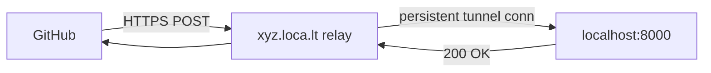

# Exposing your server — from localhost to the internet

A subscriber's one hard requirement: the callback URL must be **publicly
reachable**. `localhost:8000` fails — GitHub's servers can't see your laptop.
You have three escalating options.

## Option 1: A tunnel — localhost on a public URL

A tunnel is a small program that dials *out* to a relay service, which
gives you a public hostname that forwards back down the connection to your
local server. Your laptop never opens an inbound port.

| Tool | Open source? | Account needed? | Command |
|---|---|---|---|
| **localtunnel** | ✅ | ❌ | `npx localtunnel --port 8000` |
| **zrok** | ✅ | free tier | `zrok share public http://localhost:8000` |
| **bore** | ✅ | ❌ (self-host relay) | `bore local 8000 --to bore.pub` |
| **ngrok** | ❌ | free tier | `ngrok http 8000` |



Because this repo's signature scheme doesn't include the URL (GitHub's
doesn't either), **tunneling does not break signature verification** — a
real pain point with Twilio-style URL-signed webhooks.

## Option 2: A public request inspector

When you don't even want to run a receiver — just *see* what a provider
sends — use a hosted bin. [webhook.site](https://webhook.site) gives you an
instant unique URL that displays every request's headers, body, and
signature. It's open source and self-hostable.

```bash
# see what OUR provider's deliveries look like from the outside
curl -X POST localhost:8000/subscriptions \
  -H 'Content-Type: application/json' \
  -d '{"url": "https://webhook.site/<your-unique-id>"}'
uv run python scripts/demo.py   # then refresh webhook.site
```

## Option 3: A real server (production)

In production the subscriber's endpoint is just another HTTPS route on your
app — behind your normal domain, load balancer, and TLS. The checklist:

- **HTTPS** — payloads and secrets travel in the body; TLS is mandatory.
- **Reachability** — inbound firewall/security-group rules allow the
  provider's IPs (GitHub publishes its hook IPs in its meta API).
- **Rate/behaviour expectations** — bursts happen (a busy repo's every push).
  A fast `2xx` + async processing absorbs them.

## Live demo: real GitHub webhooks to your laptop

Two minutes, no paid accounts:

```bash
uv run uvicorn app.main:app --reload
npx localtunnel --port 8000          # -> https://<random>.loca.lt
```

In a test repo on GitHub: **Settings → Webhooks → Add webhook**

| Field | Value |
|---|---|
| Payload URL | `https://<random>.loca.lt/webhooks/receive` |
| Content type | `application/json` |
| Secret | `dev-secret-change-me` (= `WEBHOOK_SECRET` in `.env`) |

GitHub immediately POSTs a signed `ping` event. Watch your dashboard update
— `X-GitHub-Event: ping` and `X-GitHub-Delivery` map onto the exact fields
our receiver reads. Push a commit for a `push` event.

!!! tip "GitHub's 'Recent Deliveries' tab"
    In the webhook settings, GitHub shows every delivery attempt, the
    request headers/body, and your response — the provider-side delivery
    log. Compare it to this repo's `GET /deliveries`.

## Gotchas

- **Tunnel URL changes on restart** (free tiers) — you'll re-paste it into
  the provider's settings each session. Paid/dedicated tunnels fix this.
- **localtunnel shows a password page** to first-time visitors — enter your
  public IP (`curl https://loca.lt/mytunnelpassword`) once; GitHub's servers
  hit the endpoint directly so it doesn't matter for them.
- **Corporate proxies** can block outbound tunnel connections — try a
  different tool, or run the receiver on a small cloud VM instead.
- **The provider must reach you at delivery time.** If your tunnel is down,
  deliveries fail — but a good provider retries for hours, so transient
  downtime self-heals.
