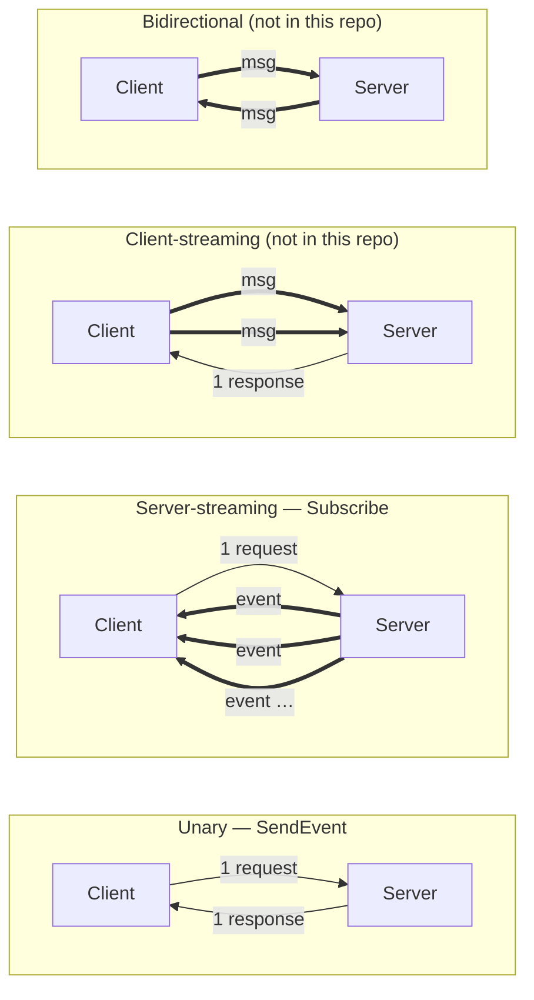

# gRPC: contracts and streams

`eventbus/` holds the contract for a tiny event bus — emit events,
subscribe to them live — with `server/`, `client/`, and `ui/` as three
separate pieces built on it.

## The four RPC shapes

RPCs aren't just request/response. Four shapes exist —

| Shape | Signature | In this repo |
|---|---|---|
| **Unary** | `SendEvent(req) -> resp` | emit one event |
| **Server-streaming** | `Subscribe(req) -> stream Event` | the subscription |
| Client-streaming | `stream Req -> resp` | — |
| Bidirectional | `stream Req <-> stream Resp` | closest thing to a WebSocket |



## The subscription, reinvented

Compare "subscribe" across transports:

```text
webhook:   POST /subscriptions {"url": "..."}   →  later: POSTs to that URL
websocket: GET /ws/events (upgrade)             →  events pushed down the socket
grpc:      Subscribe()                          →  events pushed down the call
```

The gRPC `Subscribe` call is the cleanest expression of the idea — the
streaming response *is* the subscription, and it appears in the type
signature:

```proto
rpc Subscribe(SubscribeRequest) returns (stream Event);
```

## The pieces here

| File | Role |
|---|---|
| `eventbus/events.proto` | the contract — `EventBus` service, `SendEvent` + `Subscribe` |
| `eventbus/events_pb2*.py` | generated stubs — regenerate with the `protoc` command in the `.proto` header |
| `server/server.py` | `EventBusServicer` — fan-out via a `queue.Queue` per subscriber |
| `client/demo.py` | client — opens a `Subscribe` stream, sends events, prints deliveries |
| `ui/` | browser UI — FastAPI bridge that is itself a gRPC client |

`SendEvent` fans out onto every subscriber's `queue.Queue`; each
`Subscribe` generator drains its own queue onto the wire. That is the
whole delivery engine — a webhook provider does the same shape of fan-out
but over one `POST` per subscriber URL, with signatures and retries that
gRPC streams don't need.

```mermaid
flowchart TB
    subgraph clients["gRPC clients"]
        A["Client A<br/>SendEvent('order.created')"]
        B["Client B<br/>Subscribe() — stream open"]
        C["Client C<br/>Subscribe() — stream open"]
    end

    subgraph server["server/server.py — EventBusServicer"]
        SE["SendEvent()<br/>build Event<br/>id · type · ts · data"]
        Q1[["queue.Queue"]]
        Q2[["queue.Queue"]]
        G1["Subscribe() generator<br/>q.get() → yield Event"]
        G2["Subscribe() generator<br/>q.get() → yield Event"]
    end

    A -- "unary RPC" --> SE
    SE -- "q.put(event)" --> Q1
    SE -- "q.put(event)" --> Q2
    SE -- "response: delivered_to=2" --> A
    Q1 --> G1
    Q2 --> G2
    G1 == "stream" ==> B
    G2 == "stream" ==> C

    style server fill:#1a2332,stroke:#58a6ff
    style Q1 fill:#2d333b
    style Q2 fill:#2d333b
```



## Run it

```bash
# terminal 1 — the gRPC server
uv run python -m server.server           # :50051

# terminal 2
uv run python -m client.demo
```

Output shows `SendEvent` returning the created `Event` plus
`delivered_to: 1`, then the open `Subscribe` stream printing the same
event. If the stream drops, the client simply reconnects and calls
`Subscribe` again.

## What's different from webhooks and WebSockets

- **The contract is real.** A `.proto` is versioned, reviewable, and
  generates both sides — JSON-over-HTTP APIs have no equivalent built-in
  contract.
- **No public URL needed** — like websockets, subscribers dial out.
- **No signature machinery** — auth happens per-call with TLS/mTLS or
  call credentials, the way HTTPS API calls are authenticated.
- **Browser caveat**: browsers can't speak gRPC natively — gRPC-Web needs
  a translating proxy. For browser push, websockets (or SSE) remain the
  pragmatic choice.
- **Streams backpressure naturally** — HTTP/2 flow control slows the
  sender when the client can't keep up. A fire-and-forget `POST` only
  knows "delivered" or "retry".

## Check yourself

<quiz>
Which RPC shape is the `Subscribe` call in this repo?
- [ ] Unary — one request, one response
- [x] Server-streaming — one request, then a stream of events
- [ ] Client-streaming — a stream of requests, one response
- [ ] Bidirectional — streams in both directions
</quiz>

<quiz>
When does the server stop trying to deliver an event to a subscriber?
- [x] When the `Subscribe` call ends — a closed stream gets nothing, and there is nothing to retry
- [ ] After three failed delivery attempts
- [ ] When the subscriber's callback URL returns a non-2xx status
</quiz>

<quiz>
What does `delivered_to` in the `SendEventResponse` count?
- [ ] Events sent so far in total
- [x] How many `Subscribe` streams were open when the event was emitted
- [ ] Messages remaining in the subscriber's queue
</quiz>

## Try it

- `grpcurl` can poke the server by hand (enable reflection first — left
  as an exercise).
- Edit `events.proto` to add a `ListEvents` unary RPC, regenerate the
  stubs (command in the file header), and implement it — the proto →
  generate → implement loop is the whole gRPC workflow.
