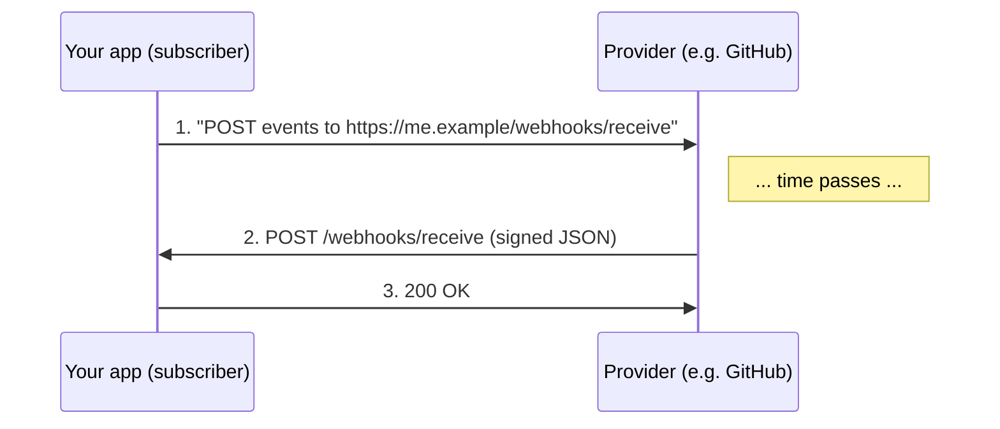

# webhooks-101

A hands-on guide to **webhooks**, built around a working playground you
can run locally: a tiny FastAPI app that is **both** a webhook provider
and a webhook receiver, so you can watch the entire lifecycle in one
process.

## What is a webhook?

A webhook is a **reversed API call**. With a normal API, *you* call the
service to ask "did anything happen?". With a webhook, you give the service
a URL once, and *it* calls *you* the moment something happens:



No polling, no waiting — the provider pushes the event to you.

## The two roles

| Role | Also called | What it does | In this repo |
|---|---|---|---|
| **Provider** | publisher, sender, *notification server* | Owns the events. Lets others subscribe, then POSTs signed events to them | `POST /emit`, `app/dispatcher.py` |
| **Subscriber** | consumer, receiver, listener | Owns the callback URL. Registers it with the provider, receives and processes events | `POST /webhooks/receive` |

!!! info "Who acts as the subscriber?"
    **You do** — whoever wants to be notified. When you paste a URL into
    GitHub's *Settings → Webhooks* page, your application is the subscriber
    and GitHub is the provider. Confusingly, some docs call the *provider*
    the "webhook" itself — read [The players](concepts/roles.md) for the
    full vocabulary.

## Run it

```bash
uv sync
cp .env.example .env

# terminal 1 — the server (provider AND receiver in one)
uv run uvicorn app.main:app --reload

# terminal 2 — the whole lifecycle in one command
uv run python scripts/demo.py
```

Open <http://localhost:8000> for the **live dashboard** — an interactive
view of the whole lifecycle: subscribe URLs, emit events, and watch signed
deliveries retry and land. See [The dashboard](dashboard.md) for a tour of
each panel. Start with the **valid**, **tampered**, and **replay** experiments:
predict the status, run the request, then inspect the response and raw bodies.
Next add healthy/flaky/dead subscribers and compare their retry timelines.
The [browser learning path](exercises.md#browser-learning-path) follows this exact
sequence. Tests: `uv run pytest`.

This is an unauthenticated local learning tool. Use synthetic data; do not deploy
it as a public webhook service. All state resets when the process restarts.

Serve this documentation locally:

```bash
uv run mkdocs serve -a 127.0.0.1:8001   # separate port from the playground
```

## Where to go next

1. [The dashboard](dashboard.md) — the fastest way to *see* it: panels for
   subscriptions, emitting, deliveries/retries, and received events.
2. [The players](concepts/roles.md) — who is the subscriber, who is the
   notification server, and what each owes the other.
3. [Anatomy of a delivery](concepts/anatomy.md) — the exact headers and
   body every webhook carries (the same ones the dashboard shows per delivery).
4. [Receiving](receiving.md) / [Sending](sending.md) — the two halves of
   the implementation.
5. [Security](security.md) — how signatures prove a request is genuine.
6. [Exposing your server](exposing.md) — tunnels, and how to receive *real*
   GitHub webhooks on your laptop.
7. [Alternatives to webhooks](concepts/delivery-options.md) — when
   websockets or gRPC streams are the better tool.
8. [Exercises](exercises.md) — hands-on tasks that cement it all.

## The sibling playgrounds

This repo is one of three — the same toy flow over different transports:

- **`../websockets-101`** — events pushed down open sockets: no public
  URL, no signatures, no retries.
- **`../grpc-101`** — events over a server-streaming RPC: the open call
  *is* the subscription.
