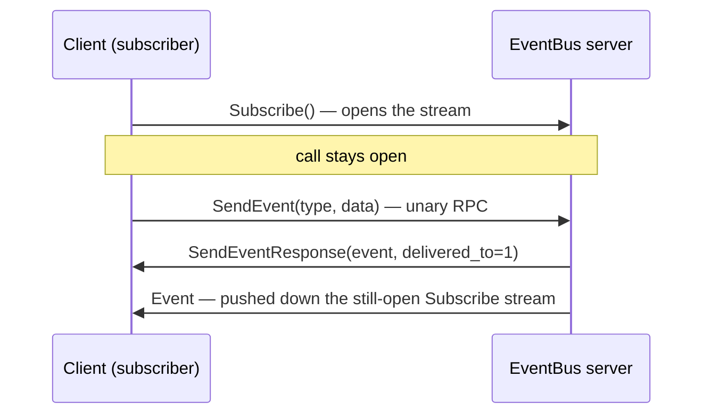
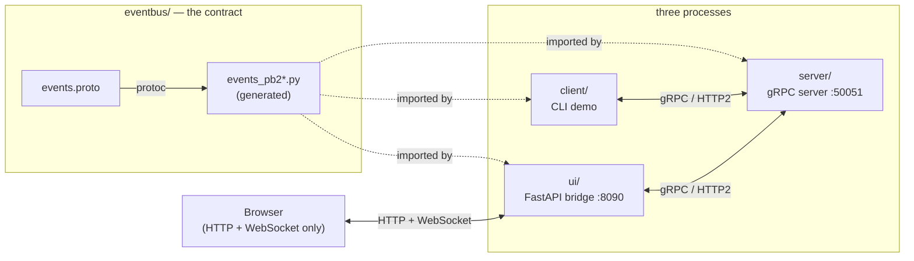

# grpc-101

A hands-on guide to **gRPC**, built around a working playground you can
run locally. `eventbus/` is an `EventBus` contract whose two RPCs cover
the two shapes you'll use most:

- `SendEvent` — **unary**: one request, one response.
- `Subscribe` — **server-streaming**: the open call is the subscription;
  events stream back to the client as they happen.

## What is gRPC?

gRPC is RPC over HTTP/2 with **Protocol Buffers** as the contract. A
`.proto` file declares the service once; `protoc` generates typed client
and server code in every major language. On the wire, payloads are
compact binary protobuf and HTTP/2 multiplexes many calls over one
connection.



## The playground at a glance

One contract, three separate pieces built on it:



The proto file is the single source of truth — `protoc` generates the
stubs, and the server, CLI client, and UI bridge all import them.

## Run it

```bash
uv sync

# terminal 1 — the gRPC server
uv run python -m server.server        # :50051

# terminal 2 — the client demo
uv run python -m client.demo
```

Tests: `uv run pytest`.

Serve this documentation locally:

```bash
uv run mkdocs serve   # http://127.0.0.1:8000 (or the port it prints)
```

## Check yourself

<quiz>
Where does the `EventBus` service contract live?
- [ ] Inside `server/server.py` as Python type hints
- [x] In `eventbus/events.proto` — `protoc` generates the Python stubs from it
- [ ] In the FastAPI bridge's OpenAPI schema
</quiz>

<quiz>
Which processes in the playground speak gRPC?
- [ ] Only `server/` — clients speak HTTP
- [ ] The browser, the bridge, and the server
- [x] `server/`, `client/`, and `ui/` — the browser never touches gRPC, the bridge calls the real stubs
</quiz>

## Where to go next

1. [gRPC: contracts and streams](grpc.md) — the `.proto` contract, the
   four RPC shapes, and how the server fans out to subscribers.
2. [Exercises](exercises.md) — extend the contract, poke it with
   `grpcurl`, add streaming in the other direction.

## The sibling playgrounds

This repo is one of three:

- **`../webhooks`** — the same flow over signed HTTP `POST`s with
  retries: what you use when the two sides are strangers on the internet.
- **`../websockets-101`** — the same flow over one bidirectional socket:
  what you use for live clients you control.
