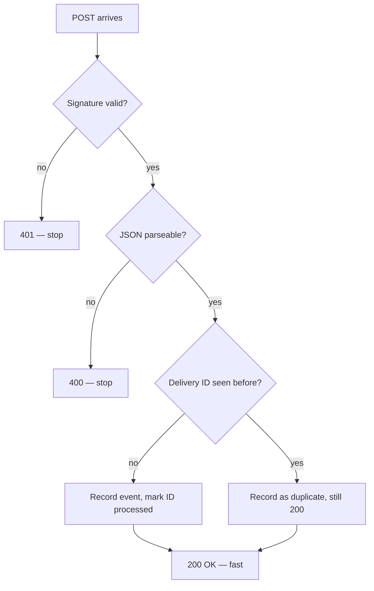

# Receiving webhooks

The subscriber side: a plain HTTP endpoint that plays by webhook rules.
This repo's receiver is `POST /webhooks/receive` in `app/main.py`.

## The checklist every receiver follows



### 1. Verify the signature first — before anything else

Until verification passes, the request is just anonymous bytes from the
internet. The signature check is a pure function of `(secret, raw body,
signature header)`:

```python
body = await request.body()                      # raw bytes, NOT parsed JSON
signature = request.headers.get("X-Hub-Signature-256")
if not verify(settings.webhook_secret, body, signature):
    raise HTTPException(401, "Invalid signature")
```

Why `401` and not `400`? From the sender's perspective the request is
*unauthenticated* — same category as a missing API key.

### 2. Deduplicate on the delivery ID

Webhooks are **at-least-once**: retries, timeouts, and provider quirks mean
the same delivery can land twice. The receiver keeps a set of processed
delivery IDs:

```python
duplicate = delivery_id in store.seen_delivery_ids
store.seen_delivery_ids.add(delivery_id)
```

In production that's a database row or a Redis `SET NX` with an expiry. The
important detail: a duplicate still gets a `200` — the provider did its job;
you just don't process the event twice.

### 3. Respond fast, work later

Providers time out in seconds. The pattern in real systems:

```text
receive -> verify -> enqueue job -> 200 OK
                                  (worker processes the event async)
```

Here the "work" is just appending to an in-memory list, so it's instant —
but keep the ordering in mind.

### 4. Return what the provider expects

Almost always a bare `2xx`. Some providers use the body (Twilio's TwiML is a
famous exception — the response *is* the program), but for JSON webhook
deliveries the body is ignored.

## The demo endpoints

| Endpoint | Behavior | What it teaches |
|---|---|---|
| `POST /webhooks/receive` | Verify → dedupe → record | A real receiver |
| `POST /webhooks/flaky` | `500`s the first 2 attempts, then `200` | Retries actually work — watch `X-Webhook-Attempt` |
| `POST /webhooks/dead` | Always `500` | What "delivery failed permanently" looks like |
| `GET /events` | Lists everything recorded | Receiver-side state |

Try it:

```bash
# valid signed event -> 200
uv run python scripts/send.py --event order.created --data '{"order_id": 42}'

# forged signature -> 401
uv run python scripts/send.py --bad-secret
```

## Common receiver bugs

| Bug | Symptom |
|---|---|
| Verifying the *parsed* JSON instead of raw body | Signature fails intermittently — key order/whitespace changes the bytes |
| `==` instead of constant-time compare | Works, but is a timing-attack vulnerability |
| Processing before verifying | Forged events execute real business logic |
| Slow handler | Provider times out → retries → duplicates you "never sent" |
| No dedup | A flaky network processes the same order twice |
