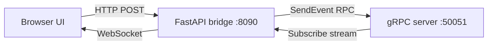
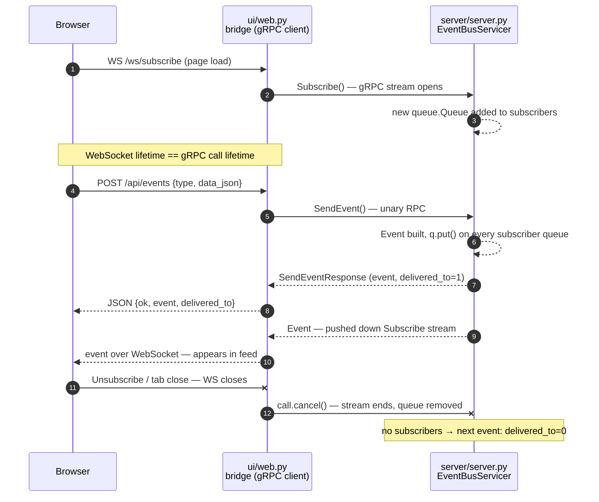

# Web UI

The playground ships a small browser UI so you can watch both RPC shapes
in action without writing a client.

## Run it

```bash
# terminal 1 — the gRPC server (the real thing, on :50051)
uv run python -m server.server

# terminal 2 — the UI bridge
uv run python -m ui.web            # http://localhost:8090
```

Open http://localhost:8090. The page opens a `Subscribe` stream on load —
then every event you send appears live in the feed.

## What the page shows

- **Status pill** (top right) — polls `/api/health`, which does a real
  `channel_ready_future` check against `:50051`. Red pill = start the
  gRPC server.
- **Send an event** (left) — one click = one `SendEvent` unary RPC. The
  result line shows the returned `event.id` and `delivered_to` — how
  many open `Subscribe` streams received it.
- **Live stream** (right) — a WebSocket mirror of one `Subscribe` call.
  Unsubscribe/re-subscribe to watch `delivered_to` go to 0 and back: if
  the stream isn't open, the event is gone — there is nothing to retry.

## Why a bridge?

Browsers can't speak gRPC's HTTP/2 framing natively (gRPC-Web exists but
needs a proxy like Envoy). So `ui/web.py` is a thin FastAPI app
that is itself an ordinary **gRPC client**:

| Browser side | Bridge | gRPC side |
|---|---|---|
| `POST /api/events` | → `SendEvent` | unary RPC |
| `WS /ws/subscribe` | → `Subscribe` | server-streaming RPC |
| `GET /api/health` | → channel readiness | connectivity check |



## One event, end to end

What happens from page load to seeing an event appear:



Nothing is re-implemented — the bridge calls the same generated stubs
(`events_pb2`, `events_pb2_grpc`) the CLI demo uses. The event bus, the
queues, and the fan-out all still live in `server/server.py`.

## Check yourself

<quiz>
Why does the browser need `ui/web.py` in between it and the gRPC server?
- [x] Browsers can't open raw gRPC/HTTP2 streams — the bridge translates WebSocket/HTTP into real gRPC calls
- [ ] To encrypt the protobuf payloads
- [ ] gRPC servers can't handle more than one client at a time
</quiz>

<quiz>
Clicking **Unsubscribe** in the UI does what on the gRPC side?
- [ ] Sends a `SendEvent` with an empty type
- [x] Closes the WebSocket, which triggers `call.cancel()` — ending the `Subscribe` stream server-side
- [ ] Nothing — the stream stays open until the server restarts
</quiz>

<quiz>
You send an event and see `delivered_to: 0`. What happened?
- [ ] The event was rejected by the server
- [ ] The browser WebSocket was still connecting — it only missed the first event
- [x] No `Subscribe` stream was open at that moment — the event was delivered to nobody, and it's gone
</quiz>

## Files

| File | Role |
|---|---|
| `ui/web.py` | FastAPI bridge — REST + WebSocket → gRPC client calls |
| `ui/static/index.html` | single-page UI, no build step |
